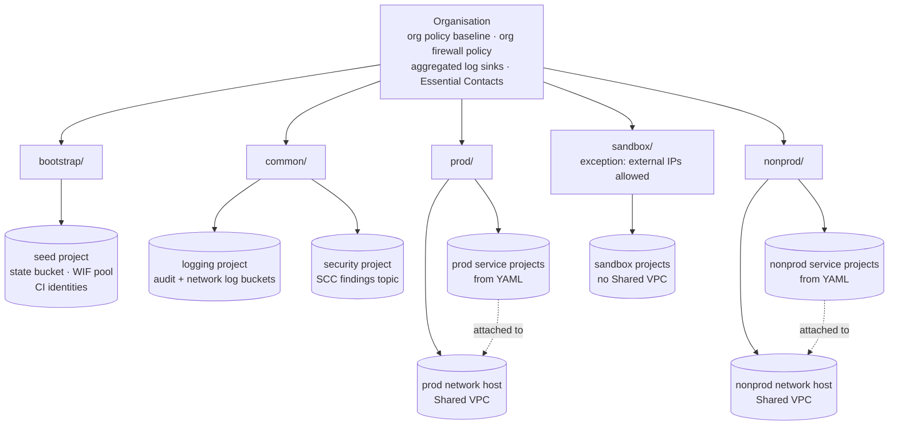
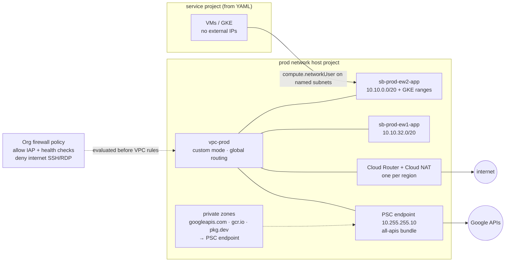

# GCP Landing Zone

[](https://github.com/mohammed-saaduddin-ansari/gcp-landing-zone/actions/workflows/ci.yml)
[](LICENSE)

An opinionated, modular Google Cloud landing zone in Terraform: resource hierarchy, organisation policy
baseline, keyless CI, Shared VPC per environment, centralised logging, a YAML-driven project factory and an
optional VPC Service Controls perimeter.

A reference implementation of the GCP foundation patterns I've designed for enterprise clients; no client
code. Everything here was written from scratch for this repository and is generic: every organisation ID,
billing account, project and group in it is a placeholder.

## What it is and why

A landing zone is the part of a cloud estate that every workload inherits and nobody wants to redo: where
projects live, who can do what, how traffic gets in and out, where the logs go and what is forbidden
outright. Getting it right early is cheap. Retrofitting it under hundreds of projects is a migration.

This repository makes a small number of firm choices and explains them:

* **Guardrails over gatekeeping.** Organisation policies make the dangerous things impossible (service
  account keys, public buckets, VMs with public IPs, default networks) so that reviews can focus on
  everything else.
* **Nothing long-lived to steal.** CI authenticates with workload identity federation, and each stage has a
  read-only plan identity and an apply identity that only a protected GitHub environment can use.
* **One network per environment, owned centrally.** Shared VPC host projects for `prod` and `nonprod`;
  application teams get subnets, not networks.
* **Logs leave the project.** Organisation-level aggregated sinks copy audit and network logs to a central
  project that application teams cannot change.
* **A project is a pull request.** One YAML file per project, with required labels, a budget and Shared VPC
  attachment, validated at plan time.
* **Small blast radius.** Four stages with separate state and separate identities. A mistake in the
  project factory cannot delete a folder.

## Architecture

### Resource hierarchy



### Network (one environment)



`prod` and `nonprod` are separate networks with no peering between them. Their address ranges do not
overlap, so they can be joined later without renumbering. See
[docs/ARCHITECTURE.md](docs/ARCHITECTURE.md) for the stage data flow, the CI identity flow, the address plan
and the logging design.

## Layout

```text
modules/                  reusable modules, each with tests/ and a generated README
  resource-hierarchy/     folders (and optional subfolders)
  org-policies/           organisation policy baseline and folder exceptions
  iam/                    group-only, additive IAM at org/folder/project level
  bootstrap/              seed project, state bucket, CI identities, workload identity federation
  logging/                aggregated org sinks, log buckets, optional locked GCS archive
  shared-vpc/             host project network, subnets, Cloud NAT, DNS logging
  firewall-policy/        hierarchical firewall policy and associations
  private-service-connect/ PSC endpoint for Google APIs and the private DNS for it
  project-factory/        projects with labels, APIs, IAM, budgets and Shared VPC attachment
  security-baseline/      SCC findings to Pub/Sub, Essential Contacts
  vpc-service-controls/   optional service perimeter, dry-run by default
envs/                     compositions, applied in order, each with its own state and identity
  0-bootstrap/            run once by a person
  1-org/                  folders, policies, logging, security, firewall, IAM
  2-networking/           host project + Shared VPC + PSC per environment
  3-projects/             project factory driven by projects/*.yaml
docs/                     ARCHITECTURE.md and DECISIONS.md (ADRs)
```

## Modules

| Module | Purpose | Key safeguards |
| --- | --- | --- |
| [resource-hierarchy](modules/resource-hierarchy) | `bootstrap`, `common`, `prod`, `nonprod`, `sandbox` folders | deletion protection, name validation |
| [org-policies](modules/org-policies) | Baseline constraints at org; exceptions at folders | exactly-one-rule validation, customer-ID format check |
| [iam](modules/iam) | Role grants for groups at org, folder and project | rejects non-group members and basic roles |
| [bootstrap](modules/bootstrap) | Seed project, state bucket, WIF, per-stage plan/apply identities | versioned state, no keys, repository allow-list |
| [logging](modules/logging) | Org-level aggregated sinks to central log buckets; optional archive | per-bucket retention, writer identity scoped to its bucket |
| [shared-vpc](modules/shared-vpc) | Host VPC, subnets, Cloud NAT, DNS policy | PGA and flow logs on by default, CIDR validation |
| [firewall-policy](modules/firewall-policy) | Hierarchical firewall policy | unique priorities, ingress/egress range checks |
| [private-service-connect](modules/private-service-connect) | PSC endpoint for Google APIs + private DNS | Google's endpoint naming rule enforced |
| [project-factory](modules/project-factory) | Projects from definitions, budgets, Shared VPC attachment | required labels, display-name rules, group-only IAM |
| [security-baseline](modules/security-baseline) | SCC findings to Pub/Sub, Essential Contacts | category validation |
| [vpc-service-controls](modules/vpc-service-controls) | Service perimeter around sensitive projects | dry-run default, project-number check |

Each module README has a usage example and generated inputs and outputs.

## Quickstart

### Run the checks locally (no Google Cloud account needed)

Prerequisites: Terraform 1.9 or later (CI uses 1.16.6), TFLint, terraform-docs and checkov.

```bash
make help        # list targets
make lint        # fmt-check, validate, tflint, checkov, docs check
make test        # terraform test for every module and stage, against mocked providers
make docs        # regenerate the module READMEs
pre-commit install
```

`make validate` and `make test` run `terraform init -backend=false`, and every test suite uses
`mock_provider "google"`, so none of this touches a cloud account or needs credentials.

### Deploy to a real organisation

You need an organisation, a billing account, and a person with Organisation Administrator and Billing Account
User for the one-off bootstrap. Create the groups referenced in `envs/1-org/terraform.tfvars.example` in
Cloud Identity or Google Workspace first.

```bash
# 0. Bootstrap (once, as a person)
cd envs/0-bootstrap
cp terraform.tfvars.example terraform.tfvars    # edit
terraform init && terraform apply
# migrate state into the new bucket: see envs/0-bootstrap/README.md

# 1-3. Each later stage, normally from CI as that stage's identity
cd ../1-org
cp terraform.tfvars.example terraform.tfvars    # edit
cp backend.hcl.example backend.hcl              # edit
terraform init -backend-config=backend.hcl
terraform plan
```

Outputs flow forward by hand: `folder_ids` from `1-org` goes into `2-networking` and `3-projects`, and
`host_projects` from `2-networking` goes into `3-projects` (ADR-001 explains why). To add a project, add a
YAML file to [envs/3-projects/projects/](envs/3-projects/projects/README.md).

I have not applied this repository to a live organisation from this codebase. Everything is validated, linted
and unit-tested against the real provider schema with mocked APIs; see [Testing](#testing) for what that does
and does not prove.

## Design decisions and trade-offs

Full reasoning, with the alternatives considered, is in [docs/DECISIONS.md](docs/DECISIONS.md). In short:

**Shared VPC per environment vs a VPC per project.** Per-project VPCs give teams autonomy but scatter network
ownership: every team needs its own NAT, its own firewall hygiene and its own private access set-up, and
connecting them later means peering limits or a hub. Shared VPC keeps routing, NAT, DNS and egress in one
place per environment, owned by the network team, while service projects keep their own IAM, billing and
quotas. The cost is a central team on the critical path for new subnets, and host project quotas shared by
every service project. (ADR-005)

**Hub-and-spoke vs Network Connectivity Center.** There is no hub here yet, deliberately. Environments are
isolated and nothing needs transit between them. When hybrid connectivity arrives, NCC with VPC spokes is the
direction of travel: it avoids VPC peering's non-transitivity and peering-group limits and centralises
hybrid routes. A classic peered hub with appliance VMs is only worth it if traffic must be inspected by a
third-party firewall. The non-overlapping address plan keeps that decision open. (ADR-005)

**Organisation policy choices.** Deny at the organisation, allow by exception at a folder, never at a
project. The baseline blocks the paths behind most real cloud incidents: leaked keys, public buckets,
internet-exposed VMs and databases, default networks with permissive rules. `sandbox` carries one exception
(external IPs) so experiments are not blocked. Domain-restricted sharing and resource locations are inputs,
not defaults, because they are organisation-specific. (ADR-008)

**Workload identity federation over keys.** A service account key is a long-lived bearer credential that
ends up in CI secrets, laptops and logs. WIF exchanges a short-lived GitHub OIDC token for short-lived Google
credentials, and the trust can be narrowed to one repository and one GitHub environment. Key creation is
then forbidden by organisation policy, so there is no fallback to abuse. (ADR-003)

**Logging design.** Aggregated sinks at the organisation, not per-project sinks: projects cannot opt out,
and logs outlive the projects that wrote them. Destinations are Cloud Logging buckets rather than BigQuery,
because they are queryable without a pipeline and retention is set per bucket. Audit logs are kept for 400
days and network logs for 30. A Cloud Storage archive with a retention policy is optional for long
compliance windows. (ADR-007)

**Additive, group-only IAM.** People get access through groups managed in the identity provider, so
joiners and leavers never touch Terraform. Grants are additive because authoritative bindings at
organisation or folder level can silently strip service-agent and break-glass grants. (ADR-006)

## Cost notes

There are no prices here because they vary by region, change over time and depend on volume. These are the
things in this design that cost money, and the levers for each:

* **Cloud NAT**: charged per gateway and per GB processed. One gateway per region with subnets; fewer
  regions means fewer gateways.
* **VPC flow logs**: billed as log ingestion. Sampling defaults to 0.5 and can be set per subnet
  (`nonprod` uses 0.1 in the example); the central network bucket keeps 30 days.
* **Cloud Logging**: ingestion beyond the free allotment, and retention beyond the default 30 days, are
  charged. The `_Required` bucket (Admin Activity, System Event) is free. Data Access audit logs are the
  biggest variable and are off by default.
* **Log archive**: the `ARCHIVE` storage class is cheap to store and expensive to read, with a minimum
  storage duration; it suits write-once compliance copies.
* **PSC endpoint**: an hourly charge per endpoint plus data processed. One per environment.
* **Cloud DNS**: per managed zone and per query. Three private zones per environment.
* **Security Command Center**: Standard is free; Premium and Enterprise are priced by the organisation's
  usage and are a commercial decision outside this code.
* **Budgets** cost nothing and only alert. They do not stop spend.

## Testing

| Layer | Tool | What it proves |
| --- | --- | --- |
| Formatting | `terraform fmt -check` | Consistent style |
| Static validity | `terraform validate` per module and stage | Configuration matches the real google provider schema (v8.10) |
| Unit tests | `terraform test` with `mock_provider` | Inputs map to the intended resources and attributes; validations and preconditions reject bad input |
| Lint | TFLint (terraform + google rulesets) | Unused declarations, undocumented variables, invalid machine types and similar |
| Security | checkov, with a [documented skip list](.checkov.yaml) | Common misconfigurations |
| Docs | terraform-docs `--output-check` | READMEs match the code |

What the mocked tests do not prove: that the APIs accept these requests, that IAM is sufficient, or that
eventual consistency and ordering hold up on a real apply. That needs a disposable test organisation and an
integration run, which is on the roadmap. The tests have already caught real defects during development: a
`for_each` keyed on values unknown until apply, and project display names the API would have rejected.

## Deliberately out of scope

* **Hybrid connectivity** (Interconnect, HA VPN, NCC hub). The address plan leaves room for it.
* **Identity provider set-up**: creating groups, SSO and super-admin hygiene in Cloud Identity or Workspace.
* **Workload modules**: GKE clusters, Cloud SQL, load balancers. This is the floor they stand on.
* **Encryption key hierarchy** (Cloud KMS, Autokey, CMEK-by-policy). State and archive buckets accept a
  KMS key, but no key rings are created.
* **Assured Workloads and sovereign controls.**
* **SCC activation and tier choice**, and **billing export to BigQuery**, which are console or commercial
  steps.
* **Break-glass procedure**: the accounts and the runbook belong to the organisation, not to a public
  repository.

## Roadmap

* Network Connectivity Center hub for hybrid and inter-environment connectivity.
* Custom organisation policy constraints and the newer managed constraints, rolled out with Org Policy
  dry-run.
* Resource Manager tags for conditional org policies and tag-based firewall targeting.
* VPC Service Controls ingress and egress policies as inputs, and perimeter bridges.
* Per-stage state buckets, or IAM conditions on state prefixes.
* An apply workflow on `main` behind GitHub environment approvals.
* Folder-scoped or custom roles for CI identities instead of organisation-level predefined roles.
* Integration tests against a disposable test organisation.
* Cost estimates on pull requests.

## Licence

[MIT](LICENSE) © Mohammed Saaduddin Ansari
