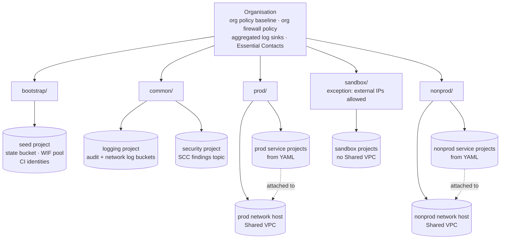
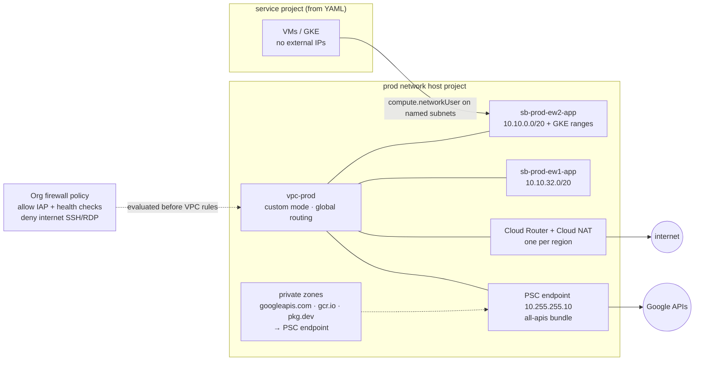

# GCP Landing Zone

[](https://github.com/mohammed-saaduddin-ansari/gcp-landing-zone/actions/workflows/ci.yml)
[](LICENSE)

An opinionated Google Cloud landing zone in Terraform: resource hierarchy, an organisation policy baseline, CI without service account keys, a Shared VPC per environment, centralised logging, a project factory driven by YAML and an optional VPC Service Controls perimeter.

## Why I built this

A landing zone is the part of a cloud estate every workload inherits and nobody wants to redo: where projects live, who can do what, how traffic gets in and out, where logs go and what's forbidden outright. It's cheap to get right early and a migration to retrofit under hundreds of projects. The failures I keep seeing are the same ones: keys in CI, everyone an owner, a VPC per project with nobody owning egress, logs that vanish with the project, no budgets.

This is a reference implementation of the GCP foundation patterns I've designed for enterprise clients, written from scratch with no client code. Every organisation ID, billing account, project and group in it is a placeholder. I haven't applied it to a live organisation; it's validated, linted and unit-tested against the real provider schema with mocked APIs (see [Testing](#testing) for what that does and doesn't prove).

## Architecture

### Resource hierarchy



### Network (one environment)



`prod` and `nonprod` are separate networks with no peering. Their address ranges don't overlap, so they can be joined later without renumbering. [docs/ARCHITECTURE.md](docs/ARCHITECTURE.md) has the stage data flow, the CI identity flow, the address plan, the logging design and day-two operations.

## What's in it

The landing zone is applied in four stages under `envs/`, each with its own state and its own CI identities:

```text
envs/
  0-bootstrap/    seed project, state bucket, WIF, CI identities; run once by a person
  1-org/          folders, org policies, logging, security, org firewall policy, IAM
  2-networking/   host project, Shared VPC and PSC endpoint per environment
  3-projects/     project factory driven by projects/*.yaml
```

The stages are built from these modules:

| Module | Purpose | Key safeguards |
| --- | --- | --- |
| [resource-hierarchy](modules/resource-hierarchy) | `bootstrap`, `common`, `prod`, `nonprod`, `sandbox` folders | deletion protection, name validation |
| [org-policies](modules/org-policies) | Baseline constraints at org; exceptions at folders | exactly-one-rule validation, customer-ID format check |
| [iam](modules/iam) | Role grants for groups at org, folder and project | rejects non-group members and basic roles |
| [bootstrap](modules/bootstrap) | Seed project, state bucket, WIF, per-stage plan/apply identities | versioned state, no keys, repository allow-list |
| [logging](modules/logging) | Org-level aggregated sinks to central log buckets; optional archive | per-bucket retention, writer identity scoped to its bucket |
| [shared-vpc](modules/shared-vpc) | Host VPC, subnets, Cloud NAT, DNS policy | PGA and flow logs on by default, CIDR validation |
| [firewall-policy](modules/firewall-policy) | Hierarchical firewall policy | unique priorities, ingress/egress range checks |
| [private-service-connect](modules/private-service-connect) | PSC endpoint for Google APIs + private DNS | Google's endpoint naming rule enforced |
| [project-factory](modules/project-factory) | Projects from definitions, budgets, Shared VPC attachment | required labels, display-name rules, group-only IAM |
| [security-baseline](modules/security-baseline) | SCC findings to Pub/Sub, Essential Contacts | category validation |
| [vpc-service-controls](modules/vpc-service-controls) | Service perimeter around sensitive projects | dry-run default, project-number check |

Each module README has a usage example and generated inputs and outputs. The eight ADRs behind the design are in [docs/DECISIONS.md](docs/DECISIONS.md).

## Getting started

### Run the checks locally

No Google Cloud account needed. You'll want Terraform 1.9 or later (CI uses 1.16.6), TFLint, terraform-docs and checkov.

```bash
make help        # list targets
make lint        # fmt-check, validate, tflint, checkov, docs check
make test        # terraform test for every module and stage, against mocked providers
make docs        # regenerate the module READMEs
pre-commit install
```

`make validate` and `make test` run `terraform init -backend=false`, and every test suite uses `mock_provider "google"`, so nothing touches a cloud account or needs credentials.

### Deploy to a real organisation

You need an organisation, a billing account, and a person with Organisation Administrator and Billing Account User for the one-off bootstrap. Create the groups referenced in `envs/1-org/terraform.tfvars.example` in Cloud Identity or Google Workspace first.

```bash
# 0. Bootstrap (once, as a person)
cd envs/0-bootstrap
cp terraform.tfvars.example terraform.tfvars    # edit
terraform init && terraform apply
# migrate state into the new bucket: see envs/0-bootstrap/README.md

# 1-3. Each later stage, normally from CI as that stage's identity
cd ../1-org
cp terraform.tfvars.example terraform.tfvars    # edit
cp backend.hcl.example backend.hcl              # edit
terraform init -backend-config=backend.hcl
terraform plan
```

Outputs are carried forward by hand: `folder_ids` from `1-org` goes into `2-networking` and `3-projects`, and `host_projects` from `2-networking` into `3-projects`. To add a project, add a YAML file to [envs/3-projects/projects/](envs/3-projects/projects/README.md) and open a pull request.

## Design decisions

The full reasoning, with the alternatives I considered, is in [docs/DECISIONS.md](docs/DECISIONS.md). The ones that matter most:

**Four stages, outputs passed by hand.** Folders and org policies change a few times a year; projects change weekly. Separate state and separate identities per stage mean a mistake in the project factory can't delete a folder, and a project request doesn't need organisation-wide permissions. Outputs go forward as plain tfvars rather than `terraform_remote_state`, which would give each stage read access to the whole upstream state and couple plans together. The cost is four pipelines and some copying when an upstream stage changes, which is rare. (ADR-001)

**Workload identity federation, split plan and apply identities.** A service account key is a long-lived bearer credential that ends up in CI secrets, laptops and logs. WIF swaps a short-lived GitHub OIDC token for short-lived Google credentials. Each stage has a read-only plan identity any workflow in the repository can use, and an apply identity bound to the exact subject `repo:<owner>/<repo>:environment:<stage>`, which GitHub only issues after the environment's reviewers approve. Key creation is then forbidden by org policy, so there's no fallback to abuse. Today the CI roles are predefined and granted at organisation level, which is more than each stage strictly needs; at larger scale I'd move to folder-scoped or custom roles and per-stage state buckets. (ADR-003, ADR-004)

**Shared VPC per environment, no hub yet.** Per-project VPCs give teams autonomy but scatter network ownership: every team needs its own NAT, firewall hygiene and private access, and connecting them later runs into peering limits. Shared VPC keeps routing, NAT, DNS and egress in one place per environment, while service projects keep their own IAM, billing and quotas. The price is a central team on the critical path for new subnets, and host project quotas shared by every service project. There's no hub because nothing needs transit between environments yet. When hybrid connectivity arrives, Network Connectivity Center with VPC spokes is the direction I'd take, since it avoids peering's non-transitivity; a peered hub with appliance VMs is only worth it if traffic must pass a third-party firewall. (ADR-005)

**Deny at the organisation, allow by exception at a folder.** The baseline blocks the paths behind most real cloud incidents: leaked keys, public buckets, internet-exposed VMs and databases, default networks with permissive rules. Exceptions go on folders, never projects, so they're visible in one place; `sandbox` carries one (external IPs) so experiments aren't blocked. Domain-restricted sharing and resource locations are inputs rather than defaults because they're organisation-specific. VPC Service Controls ships in dry-run, because an enforced perimeter with a missing ingress rule breaks CI and the console immediately, and the usual outcome of enforcing on day one is an emergency rollback. (ADR-008)

**Aggregated sinks into log buckets.** Sinks at the organisation mean projects can't opt out and logs outlive the projects that wrote them. Cloud Logging buckets rather than BigQuery, because they're queryable without a pipeline and retention is set per bucket: 400 days for audit logs, 30 for network logs, with an optional Cloud Storage archive for long compliance windows. Where a SIEM exists, I'd add a Pub/Sub sink alongside rather than replace these. (ADR-007)

**Group-only, additive IAM.** People get access through groups in the identity provider, so joiners and leavers never touch Terraform, and `roles/owner` and `roles/editor` are rejected. Grants are additive because authoritative bindings at organisation or folder level can silently strip service-agent and break-glass grants. The trade-off is that access added outside Terraform isn't removed automatically, so it has to be detected with IAM Recommender, Policy Analyzer and SCC. (ADR-006)

## Testing

CI runs `terraform fmt -check`, `terraform validate` in every module and stage against the real google provider schema (v8.10), `terraform test` with `mock_provider`, TFLint with the terraform and google rulesets, checkov with a [documented skip list](.checkov.yaml), and a terraform-docs check that the READMEs match the code.

From `make test` (one suite shown), run locally with Terraform 1.16.6 and google provider 8.10.0. The full run is 57 test runs across 15 suites, all passing.

```text
==> test modules/project-factory
tests/project_factory.tftest.hcl... in progress
  run "projects_are_created_with_labels"... pass
  run "shared_vpc_and_gke_grants"... pass
  run "budget_has_actual_and_forecast_alerts"... pass
  run "rejects_missing_required_labels"... pass
  run "rejects_user_principals"... pass
  run "rejects_uppercase_labels"... pass
  run "rejects_invalid_display_name"... pass
tests/project_factory.tftest.hcl... tearing down
tests/project_factory.tftest.hcl... pass
Success! 7 passed, 0 failed.
```

The tests show that inputs map to the intended resources and that validations and preconditions reject bad input. They caught real defects during development: a `for_each` keyed on values unknown until apply, and project display names the API would have rejected. What they don't show is that the APIs accept these requests, that IAM is sufficient, or that ordering and eventual consistency hold on a real apply. That needs an integration run against a disposable test organisation, which I haven't built yet.

## What costs money

No prices here; they vary by region, change over time and depend on volume.

- Cloud NAT is charged per gateway and per GB processed. There's one gateway per region with subnets, so fewer regions means fewer gateways.
- VPC flow logs are billed as log ingestion. Sampling defaults to 0.5 and can be set per subnet (`nonprod` uses 0.1 in the example), and the central network bucket keeps 30 days.
- Cloud Logging charges for ingestion beyond the free allotment and retention beyond 30 days. The `_Required` bucket is free. Data Access audit logs are the biggest variable and are off by default.
- The `ARCHIVE` storage class for the log archive is cheap to store and expensive to read, with a minimum storage duration, which suits write-once compliance copies.
- Each PSC endpoint has an hourly charge plus data processed; there's one per environment. Cloud DNS charges per managed zone and per query, with three private zones per environment.
- SCC Standard is free. Premium and Enterprise are a commercial decision outside this code.
- Budgets cost nothing, and only alert; they don't stop spend.

## Not included

- Hybrid connectivity (Interconnect, HA VPN, an NCC hub). The address plan leaves room for it.
- Identity provider set-up: groups, SSO and super-admin hygiene in Cloud Identity or Workspace.
- Workload modules such as GKE clusters, Cloud SQL and load balancers. This is the floor they stand on.
- A key hierarchy (Cloud KMS, Autokey, CMEK by policy). State and archive buckets accept a KMS key, but no key rings are created.
- Assured Workloads and sovereign controls, SCC activation and tier choice, and billing export to BigQuery, which are console or commercial steps.
- A break-glass procedure. The accounts and runbook belong to the organisation, not a public repository.

Next on my list: an NCC hub, custom org policy constraints rolled out with Org Policy dry-run, Resource Manager tags for conditional policies and firewall targeting, VPC-SC ingress and egress policies as inputs, an apply workflow on `main`, and the integration tests above.

## Licence

[MIT](LICENSE) © Mohammed Saaduddin Ansari
