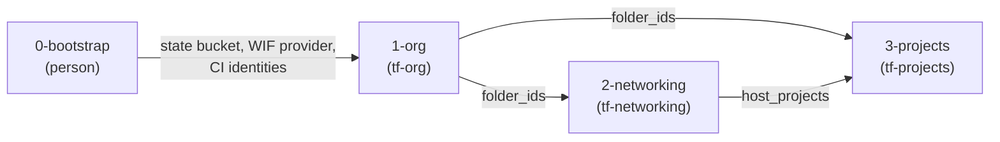
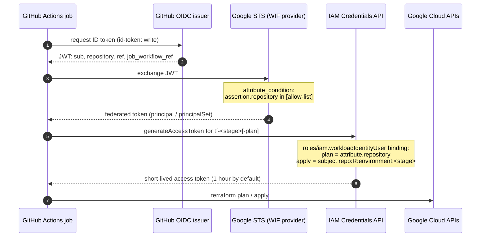
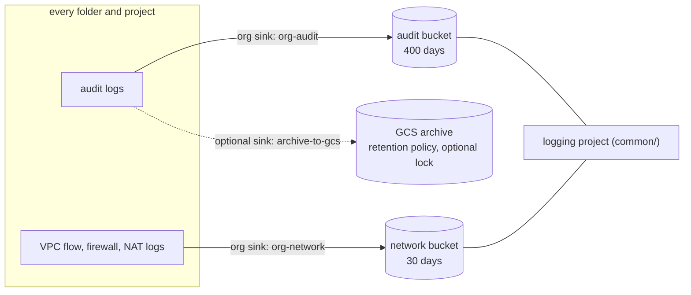

# Architecture

This document describes how the pieces fit together at run time. The reasons behind each choice are in
[DECISIONS.md](DECISIONS.md).

## Stages

The landing zone is applied in four stages. Each stage has its own Terraform state (a prefix in one state
bucket) and its own pair of CI identities, and only changes the resources it owns.

| Stage | Applied by | Owns | Reads from earlier stages |
| --- | --- | --- | --- |
| `0-bootstrap` | a person, once | `bootstrap` folder, seed project, state bucket, WIF pool and provider, CI identities | none |
| `1-org` | `tf-org` | `common`/`prod`/`nonprod`/`sandbox` folders, org policies, logging and security projects, sinks, SCC notifications, org firewall policy, org and folder IAM | seed project (quota project) |
| `2-networking` | `tf-networking` | host projects, Shared VPCs, subnets, Cloud NAT, DNS policy, PSC endpoints | `folder_ids` |
| `3-projects` | `tf-projects` | service projects, budgets, Shared VPC attachments, subnet IAM, optional VPC-SC perimeter | `folder_ids`, `host_projects` |

Outputs are passed forward as ordinary tfvars rather than read with `terraform_remote_state` (ADR-001).
Stages change at very different rates: `1-org` changes a few times a year, `3-projects` several times a
week.

## Identity and CI

Two checks happen before any credential is issued. The provider rejects tokens from repositories that are
not on the allow-list. Then the service account's own IAM policy decides which tokens may impersonate it:

* **plan identities** (`tf-<stage>-plan`) trust every workflow in the repository, including pull request
  branches. They have read-only roles at organisation level and `roles/storage.objectViewer` on state, so
  plans run with `-lock=false`. An unreviewed branch can read the estate but cannot change it.
* **apply identities** (`tf-<stage>`) trust only the exact subject `repo:<owner>/<repo>:environment:<stage>`.
  GitHub issues that subject only to jobs running in that environment, after its protection rules
  (required reviewers, deployment branch `main`) have passed.

No service account keys exist anywhere, and `iam.disableServiceAccountKeyCreation` stops anyone creating one
later. Every API call is attributed in the audit logs to the stage identity and, through the federated
principal, to the workflow run.

API calls are billed to the seed project (`billing_project` plus `user_project_override`). Some APIs,
notably Billing Budgets, refuse calls without a quota project.

## Resource hierarchy and policy inheritance

| Folder | Holds | Policy differences |
| --- | --- | --- |
| `bootstrap` | seed project | Organisation baseline only. Access limited to org admins. |
| `common` | logging project, security project | Organisation baseline. Logging viewers only for auditors and security. |
| `prod` | prod host project, prod service projects | Organisation baseline. |
| `nonprod` | nonprod host project, nonprod service projects | Baseline; developers get `roles/viewer` on the folder. |
| `sandbox` | experiments | Baseline except `compute.vmExternalIpAccess` (allow all); developers can create projects. |

Org policies, the org firewall policy and IAM all inherit downwards. The rule for exceptions is to grant them
at a folder, never at a project, so the exception is visible in one place and covers a class of workloads
rather than a single one.

## Network

### Topology

Each environment (`prod`, `nonprod`) has its own host project and Shared VPC, in the environment's folder.
Service projects attach to the host project of their environment and are granted `compute.networkUser` on
the specific subnets they need, never on the whole host project.

Egress to the internet goes through **Cloud NAT** in each region that has a subnet (VMs cannot have external
IPs). Google API traffic goes to a **Private Service Connect endpoint** inside the VPC, and private zones for
`googleapis.com`, `gcr.io` and `pkg.dev` resolve the default hostnames to that endpoint. Private Google Access
is also on for every subnet, so a Google API hostname that is not covered by the private zones still works
from VMs without external IPs.

Ingress and east-west policy is layered:

1. **Organisation firewall policy** (evaluated first): allow IAP TCP forwarding (`35.235.240.0/20`) and Google
   health checks (`35.191.0.0/16`, `130.211.0.0/22`); deny SSH and RDP from anywhere else. Everything else
   falls through.
2. **Folder policies** (none yet): the place for environment-wide rules.
3. **VPC firewall rules** in the host project: owned by the network team, requested by application teams.

### Address plan

| Range | Use |
| --- | --- |
| `10.10.0.0/16` | prod subnets |
| `10.20.0.0/16` | nonprod subnets |
| `10.255.255.0/24` | PSC endpoints (`.10` prod, `.20` nonprod) |
| `100.64.0.0/10` | GKE Pod and Service secondary ranges (RFC 6598), not routed outside the VPC |
| `10.0.0.0/16`, remaining `10.x` | reserved for on-premises and future hubs |

Ranges do not overlap between environments, so they can be connected through NCC or a hub later without
renumbering.

## Logging

* Sinks are **organisation-level aggregated sinks** with `include_children = true`. They copy logs; each
  project keeps its own `_Required` and `_Default` buckets as usual.
* Each sink's writer identity gets `roles/logging.bucketWriter` on the logging project, conditioned to its own
  bucket.
* Audit logs covered: Admin Activity, System Event, Policy Denied, Data Access (where enabled) and Access
  Transparency.
* **Data Access audit logs** are off by default and can be switched on per service at organisation level
  (`data_access_audit_services`). They are the largest cost variable in the design.
* Log buckets can be **locked** and **upgraded to Log Analytics**. Both are irreversible and default to off.

## Security controls

| Risk | Control | Where |
| --- | --- | --- |
| Leaked long-lived credentials | No SA key creation or upload; CI via WIF | `org-policies`, `bootstrap` |
| Over-privileged CI | Plan/apply identities per stage; apply bound to a protected environment | `bootstrap`, `envs/0-bootstrap` |
| Public data exposure | Uniform bucket-level access, public access prevention, Cloud SQL private IP | `org-policies` |
| Internet-exposed VMs | No external IPs (except `sandbox`), org firewall denies internet SSH/RDP | `org-policies`, `firewall-policy` |
| Accidental default networks | `compute.skipDefaultNetworkCreation`, `auto_create_network = false` | `org-policies`, `project-factory` |
| Identity sprawl | Group-only IAM; basic roles rejected; domain-restricted sharing | `iam`, `project-factory`, `org-policies` |
| Data residency | `gcp.resourceLocations` | `org-policies` |
| Exfiltration via Google APIs | VPC Service Controls perimeter (dry-run first) | `vpc-service-controls` |
| Undetected misconfiguration | SCC HIGH/CRITICAL findings streamed to Pub/Sub | `security-baseline` |
| Tampered or lost evidence | Central audit bucket in a separate project; optional locked archive | `logging` |
| Missed Google notices | Essential Contacts to group mailboxes | `security-baseline` |
| Accidental destruction | Deletion protection on folders and projects; versioned state | all |

## Static analysis

checkov runs with six deliberate skips, each explained in [`.checkov.yaml`](../.checkov.yaml):

| Check | Why it is skipped |
| --- | --- |
| `CKV_GCP_62` bucket access logging | Access is audited through Cloud Audit Logs centrally, not legacy usage logs |
| `CKV_GCP_78` versioning on the log archive | Versioning cannot be combined with a retention policy; the retention policy is the stronger control. The state bucket is versioned. |
| `CKV_GCP_74` Private Google Access | Variable-driven (default true), which checkov cannot resolve; asserted in tests |
| `CKV_GCP_125` GitHub OIDC trust | Checkov only recognises `assertion.sub ==`; trust here is a repository allow-list plus subject-bound IAM |
| `CKV2_GCP_5` per-project audit config | Configured once at organisation level |
| `CKV2_GCP_18` network defines a firewall | Firewall baseline is hierarchical, which the graph check does not follow |

As a cross-check, `trivy config --severity HIGH,CRITICAL` reports no findings on the repository.

## Operations

**Add a project.** Add `envs/3-projects/projects/<name>.yaml`, open a pull request, review the plan, merge.
Plan-time preconditions reject duplicate IDs, unknown folders, missing labels and bad subnet references.

**Add a subnet.** Add it to `environments.<env>.subnets` in `2-networking` from the address plan, then
reference it as `region/name` in the project YAML.

**Make a policy exception.** Add a folder-level call of `modules/org-policies` (as for `sandbox`) with only
the constraint being relaxed, and record why in the pull request. If the exception is for one workload,
consider a subfolder.

**Turn on VPC Service Controls.** Set `vpc_sc.enabled = true` in `3-projects` with the access policy ID, mark
projects with `vpc_sc: true`, add the prod host project number to `extra_resources`, and apply in `dry_run`.
Query `protoPayload.metadata.dryRun="true"` in the audit bucket for a few weeks, add access levels or
ingress/egress rules for legitimate traffic, then set `mode = "enforced"`.

**Recover state.** The state bucket is versioned and keeps the last 50 noncurrent versions of each object.
Restore by copying a previous generation over the current object, then `terraform plan` to confirm.
